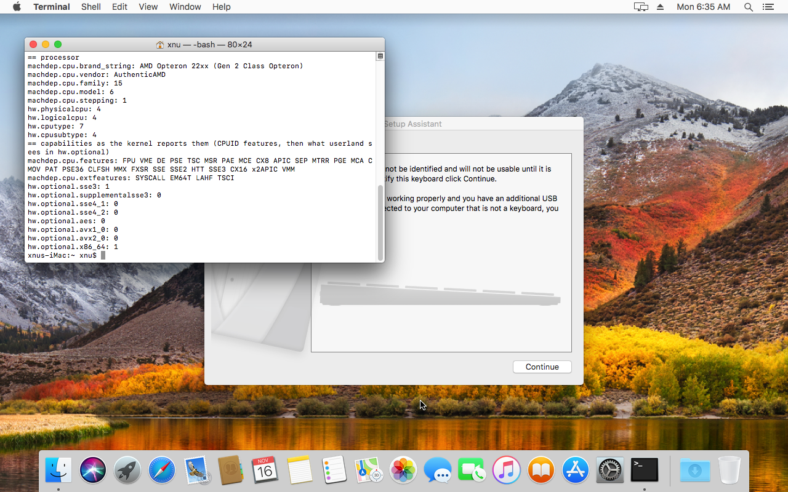

# xnu-cross: macOS High Sierra

Cross-compile Apple's xnu-4570.71.2 (macOS 10.13.6 High Sierra) on Linux with no Xcode and no Apple SDK, and boot it in QEMU/KVM against a stock High Sierra install. This is also the branch with the AMD K8/K10 patches and the OPEMU opcode emulator that the Tahoe branch was ported from.

This branch has two commits. The first is Apple's stock xnu from [apple-oss-distributions/xnu](https://github.com/apple-oss-distributions/xnu). The second is our changes plus the scripts, toolchain and docs. To see what we changed in the kernel:

```sh
git diff HEAD~1 HEAD -- src/xnu
```

The same diff is in `patches/xnu-highsierra-xcross.patch`. The source tree in the second commit is the AMD tree (the community AMD High Sierra patches with our fixes). If you want Apple's stock kernel with only the toolchain fixes, apply `patches/xnu-highsierra-toolchain-only.patch` to the first commit instead.

## Status

| Kernel | CPU model in QEMU | Result |
|---|---|---|
| Stock xnu-4570.71.2 plus toolchain fixes | Skylake-Client | Boots to the login window |
| AMD tree | Skylake-Client | Boots to the login window |
| AMD tree, `k8-sse3` baseline | Opteron_G2 (AM2, K8) | Boots to the login window under KVM |
| AMD tree, `k8-sse3` baseline | phenom model 4 (AM3, K10) | Boots to the login window under KVM |
| AMD tree, `k8-sse3` baseline, **stripped** kernel | phenom model 4 (AM3, K10) | Boots to the login window and the desktop under KVM (2026-11-17) |
| AMD tree, `k8-sse3` baseline | Opteron_G4 (AM3+, Bulldozer) | Boots to the login window under KVM |
| AMD tree, `k8-sse3` baseline, installed from the single install disk | Opteron_G2 (AM2, K8) | Clean install from the single install disk (stages 1 and 2 on this model), then boots to the desktop (QEMU, not real hardware) |
| AMD tree, `k8-sse3` baseline | phenom (K10), TCG (software CPU) | Kernel and userland run with the emulator, login window not reached in 40 minutes |

Screenshots are in [docs/TESTING.md](docs/TESTING.md). The log of what was found and fixed is in [STATUS.md](STATUS.md). To install on the kernel, see [docs/INSTALL.md](docs/INSTALL.md). To debug it, see [docs/DEBUGGING.md](docs/DEBUGGING.md).



The Terminal shows the kernel (`xnu-4570.71.2.AMD`), the CPU the guest sees (AMD Opteron, family 15) and that SSSE3, SSE4 and AVX are not there. This is a clean install from our own disk, run and booted on our kernel. It is a QEMU guest on an Intel host.

## One Kernel For K8 And K10

There is a single AMD kernel, built with the K8 baseline (`XCROSS_MARCH=k8-sse3`). It does not know which AMD CPU it is on at build time: it reads CPUID at boot, and OPEMU emulates SSSE3, SSE4 and so on only for the sets CPUID says are missing (`opemu_policy.c`, default `auto`). The same `kernel` booted `Opteron_G2` (K8) and `phenom` (K10) models. A separate K10-tuned build would only change code generation, and is not needed on High Sierra.

## Not Tested On Real AMD Hardware

Everything ran in QEMU on an Intel host. Under KVM, QEMU can present an AMD vendor string, family and feature flags, so the AMD paths in the kernel run: CPUID, TSC setup, MSR handling. What KVM cannot do is remove instructions. SSSE3 and SSE4 still execute natively on the host even when the guest's CPUID hides them, so the opcode emulator does not fire under KVM.

The emulator is exercised in two other ways:
- `scripts/opemu-hosttest.sh` compiles the real OPEMU sources on the host and compares 103 instruction forms with the host CPU's own instructions. 12 million cases, 0 mismatches.
- The TCG boot (QEMU's software CPU raises real `#UD` for the hidden instructions) runs the kernel and userland through tens of millions of emulated instructions. It is 20 to 50 times slower than KVM, which is why it never reached the login window.

A real K8 or K10 board is the missing test.

## What A Missing SSSE3 And SSE4 Means

K8 has SSE3 at best. K10 adds SSE4a but neither SSSE3 nor SSE4.1/4.2. macOS 10.13 does not check for them before using them. Its `memmove` uses `pshufb` and `palignr` unconditionally, so a K8 or K10 CPU traps all the time:

- Every SSSE3, SSE4.1, SSE4.2, POPCNT and CRC32 instruction raises `#UD` and the kernel emulates it. `pshufb` and `palignr` make up over 99% of the traps, so they have a hand-decoded fast path in `opemu_fast.c`.
- Expect a slow system. Under TCG the emulator handles about 64,000 instructions a second. How fast a real K8 or K10 takes the trap has not been measured.
- The kernel must be built for a K8-class baseline (`XCROSS_MARCH=k8-sse3`). A kernel built for the default Penryn target contains SSE4.1 in early boot code and faults before any trap handler exists.

## Prerequisites

See [REQUIREMENTS.md](REQUIREMENTS.md) for the packages and disk space. For the VM tests you also need:

- [OSX-KVM](https://github.com/kholia/OSX-KVM) checked out next to this repo (`../OSX-KVM`), with OpenCore and the OVMF files
- A macOS 10.13.6 (17G66) guest at `../OSX-KVM/mac_hdd_ng.img`, installed offline from [gibMacOS](https://github.com/corpnewt/gibMacOS) files. The test user is `xnu` with password `xnu`.
- `echo 1 | sudo tee /sys/module/kvm/parameters/ignore_msrs` (resets on host reboot)
- gdb, for [debugging](docs/DEBUGGING.md)

## Build

```sh
scripts/bootstrap.sh                                                    # once: ld64, tcsh, MIG, SDK headers
scripts/xnu-make.sh                                                     # AMD tree, Intel baseline
XCROSS_MARCH=k8-sse3 XNU_OBJ=xnu-k8 scripts/xnu-make.sh                 # AMD tree for K8/K10 class CPUs
```

`make` exits 0. It leaves two files in `build/<obj>/obj/RELEASE_X86_64/`: `kernel`, stripped with Apple's `strip` (built from cctools-port by `scripts/build-ld64.sh` into `toolchain/bin/strip-apple`), and `kernel.unstripped`, which has the symbols and is what gdb needs. `llvm-strip` cannot be used: it stops with "shared library is not yet supported" on the kernel Mach-O. The stripped `kernel` boots too: a prelinked kernel built around it reached the login window and desktop on a K10 model (docs/TESTING.md). Use `kernel.unstripped` for gdb.

## Test VM

| Item | Value |
|---|---|
| Hypervisor | QEMU/KVM, OVMF and OpenCore from OSX-KVM, started by `scripts/boot-highsierra.sh` (`CPU=` overrides the CPU model) |
| SIP | Disabled (`csr-active-config=0x7f`), set in the OpenCore image by `scripts/oc-set.sh` |
| Our kernel | Installed as `/System/Library/Kernels/kernel.xcross` and `/System/Library/PrelinkedKernels/prelinkedkernel.xcross`, selected with the boot-arg `kcsuffix=xcross`. The stock kernel stays untouched. |
| Command channel | A LaunchDaemon in the guest polls `scripts/agent-server.py` on the host (`10.0.2.2:8000`) and runs jobs as root: `scripts/guest-run.sh 'uname -a'` |
| Serial and monitor | Kernel serial log `/tmp/hs-serial.log`, QEMU monitor `/tmp/hs-monitor.sock` |

## Releases

`.github/workflows/build.yml` builds the kernel in an Arch Linux container on GitHub Actions for each variant (see the file for the list) and keeps the result as a workflow artifact on every push to this branch. Pushing a tag named `highsierra-v*` (for example `highsierra-v0.1`) also creates a GitHub release with each variant as a `.tar.xz`: the stripped kernel, `kernel.unstripped`, `BUILD-INFO.txt` and `SHA256SUMS`. The workflow has not run on GitHub yet; its steps were run in an Arch container locally.

## Real Hardware

The plan for installing and booting on a real K8 or K10 machine is in [docs/BARE-METAL.md](docs/BARE-METAL.md), with OpenCore setup and booting machines without UEFI in [docs/OPENCORE.md](docs/OPENCORE.md). It is untested, and says which steps are guesses.

## Tests

```sh
BOOTARGS='-v serial=3 keepsyms=1 kcsuffix=xcross slide=100' scripts/iterate.sh out/kernel.stock-src.x86_64   # install a kernel, reboot, report
scripts/amd-test.sh am2          # K8 model (Opteron_G2). Also: am3 (phenom), am3plus (Opteron_G4), intel
scripts/tcg-amd-boot.sh          # TCG boot of a mimicked AMD CPU, reports the OPEMU log lines
scripts/opemu-hosttest.sh 20000  # emulator against the host CPU, about 10 seconds
```

## Layout

```
src/xnu/          the AMD tree (commit 2), Apple stock (commit 1)
scripts/          build, boot, test and debug scripts
toolchain/        clang wrappers, fake xcrun, header stand-ins
patches/          xnu-highsierra-xcross.patch, xnu-highsierra-toolchain-only.patch
docs/             INSTALL.md, DEBUGGING.md, TESTING.md, OPEMU.md, NOTES.md, screenshots
```

OPEMU, its boot-args and the speed work are in [docs/OPEMU.md](docs/OPEMU.md). Scripts are listed in [docs/SCRIPTS.md](docs/SCRIPTS.md). The toolchain findings (why Apple's ld64, the stub symbols, the early SSE problem) are in [docs/NOTES.md](docs/NOTES.md).

## Credits

See the `main` branch README.
