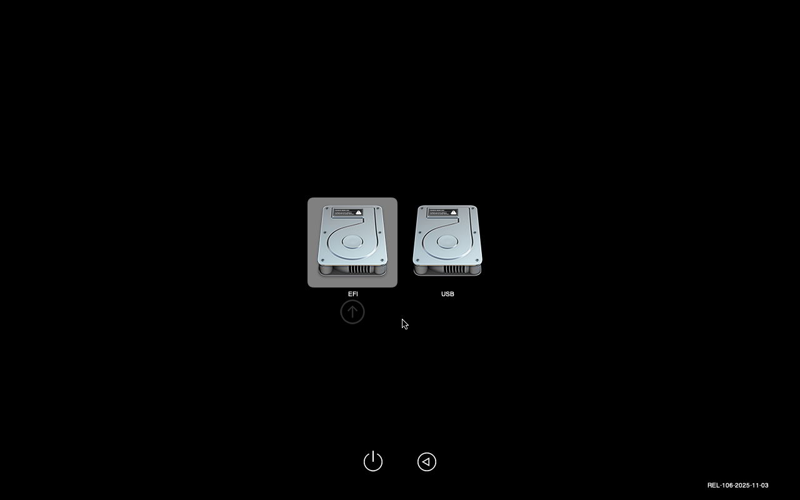
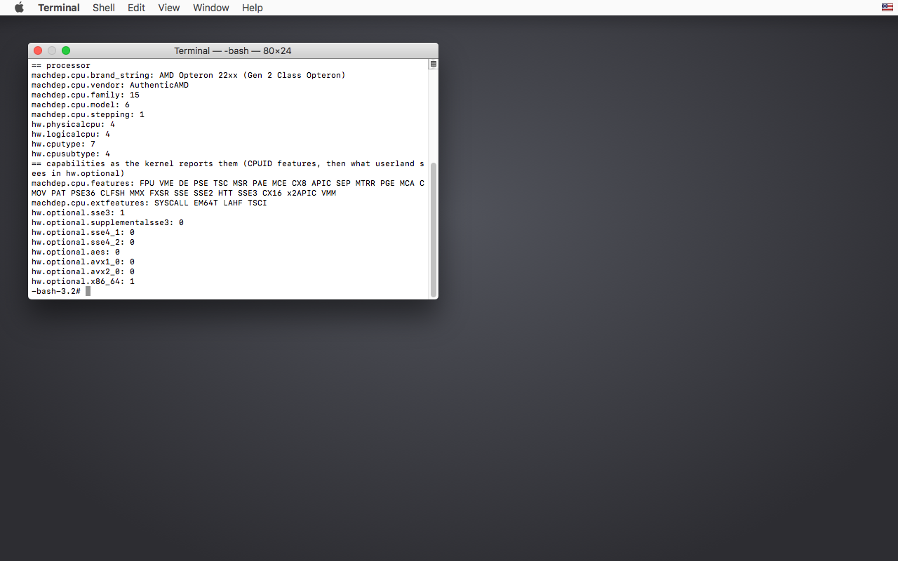
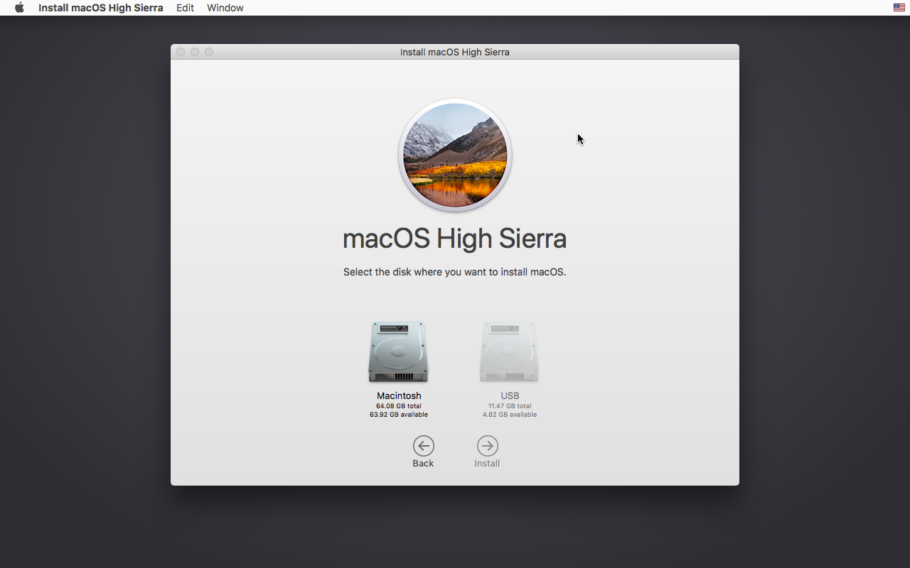
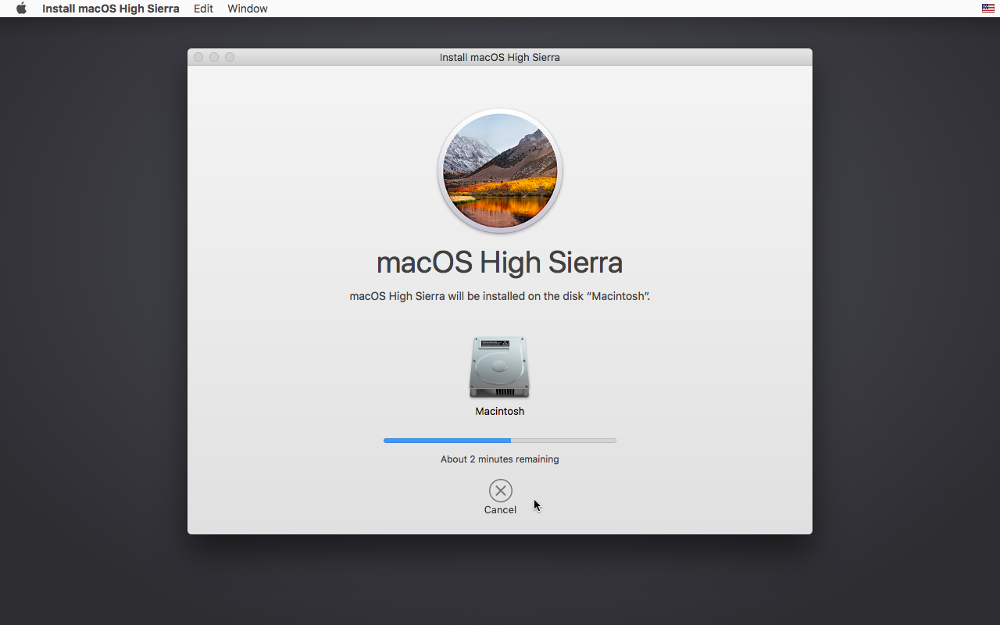
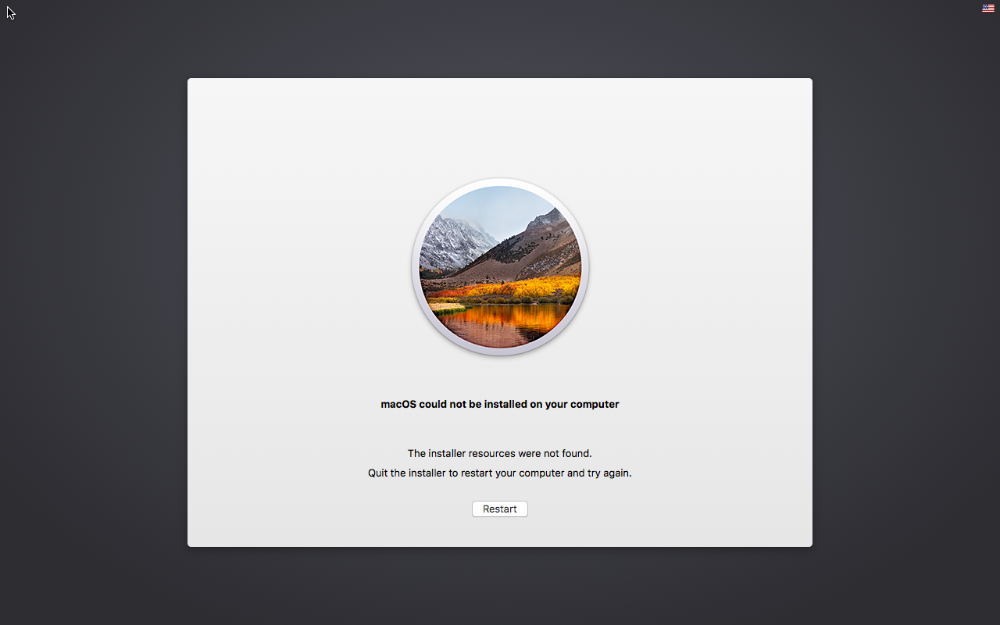
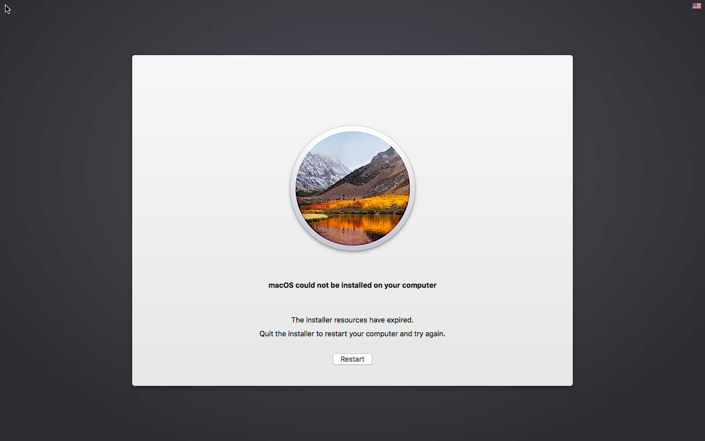
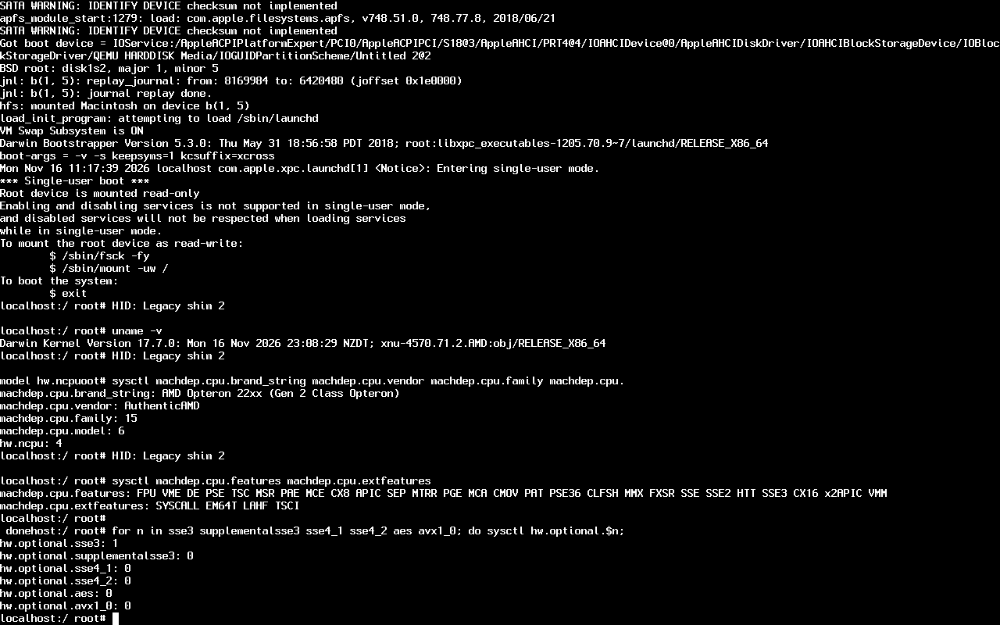
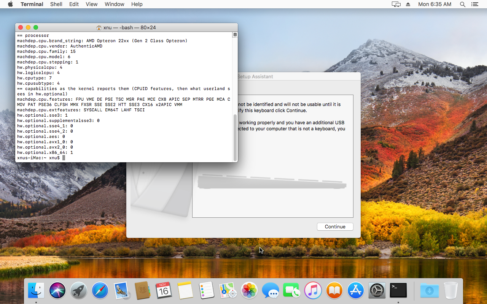

# Installing High Sierra on the AMD kernel

This guide builds one bootable disk that carries OpenCore, Apple's installer and our kernel, installs macOS 10.13.6 from it, and boots the result on our kernel. It is the classic one-USB-stick install, with OpenCore doing what Chameleon used to do.

Everything below was run in QEMU/KVM on an Intel host, with the QEMU model `Opteron_G2` (an AMD K8) for the install and the boots. Nothing has been run on real AMD hardware. A clean install of this guide, stage 2 included, was run on `Opteron_G2` on 2026-11-17 and reached the desktop.



## What you need

- A built kernel for a K8 class baseline: `XCROSS_MARCH=k8-sse3 XNU_OBJ=xnu-k8 scripts/xnu-make.sh` (README.md). The linked kernel is `build/xnu-k8/obj/RELEASE_X86_64/kernel.unstripped`.
- Apple's 10.13.6 installer files from [gibMacOS](https://github.com/corpnewt/gibMacOS): `BaseSystem.dmg`, `BaseSystem.chunklist`, `InstallESDDmg.pkg` (its payload is `InstallESD.dmg`), `AppleDiagnostics.dmg`, `AppleDiagnostics.chunklist`, `InstallInfo.plist`.
- [OSX-KVM](https://github.com/kholia/OSX-KVM) next to this repo, for OpenCore and the OVMF files.
- The full set of kexts, unpacked from the installer payload: `scripts/extract-extensions.sh <InstallESD.dmg> <dir>` (321 kexts, 1.1 GB). The installer's own copy is stripped down and does not contain `AppleUSBCommon`.
- A working installer to build the disk with: any High Sierra Recovery image (`BaseSystem-hs.img`). Creating the disk needs macOS tools (`ditto`, `hdiutil`, `kextcache`) that Linux does not have.
- About 40 GB free for the images.

## 1. Build the disk

```sh
scripts/make-install-disk.sh highsierra
```

The script stages the inputs on an exFAT disk, boots the bootstrap installer in the VM with an empty target and the staging disk attached, opens its Terminal and runs `scripts/guest/install-disk-build.sh` there. That builder:

1. partitions the target (GPT, a 200 MB EFI partition and one HFS+ volume)
2. copies `BaseSystem.dmg` onto the volume with `ditto` (`asr restore` is not supported in Recovery)
3. builds the installer layout the 10.13 installer app reads: `Install macOS High Sierra.app/Contents/SharedSupport` holding `InstallESD.dmg`, a patched `InstallInfo.plist` (URL set to `InstallESD.dmg`, chunklist keys removed), `BaseSystem.dmg` and `AppleDiagnostics.*`
4. builds a prelinked kernel around our kernel with `kextcache -z -a x86_64 -K kernel -no-authentication -all-loaded`, from the full kext set, and installs it as `kernel.xcross` and `prelinkedkernel.xcross`
5. puts OpenCore on the EFI partition: boot-args `-v keepsyms=1 kcsuffix=xcross`, SIP off, the picker timeout at 0 so it waits for you, and a scan policy that hides the `EFI` entry

The profile is `scripts/install-disk/highsierra.conf`. A profile for another macOS version is a new `.conf` next to it. Tahoe's is a stub, since its installer is not a BaseSystem plus packages layout (`createinstallmedia`).

I ran `make-install-disk.sh` from start to finish twice. The result is `install-highsierra.img` (or the path you pass). Boot it with `HS_USB=<image> scripts/boot-highsierra.sh`, or write it to a stick with `dd`.

Things that cost time:

- A prelinked kernel built from all 321 kexts is 95 MB and boot.efi fails to read it (`Read error 0x3`). The `-all-loaded` cache is 11 MB and loads.
- Apple's boot.efi only reads the kernel and prelinked kernel from the boot volume, never from the EFI partition. That is why the disk has an HFS+ volume and not just OpenCore.
- The `EFI` entry in the OpenCore picker only restarts OpenCore. Hiding it (scan policy `0x10303`, APFS and HFS on SATA) leaves one entry on a blank target, so Return boots it.
- **Check that the disk's Recovery sees USB.** One build of this disk booted Recovery to the Utilities window but never enumerated the USB controller, so no keyboard or mouse worked. Rebuilding the disk from the same inputs gave one that works, so the `-all-loaded` set is not the same every time. The check is `info usb` in the QEMU monitor: devices show `Device 0.0` when the guest never touched them, and non-zero addresses when it did.

## 2. Boot the installer on our kernel

Boot the disk and pick the `USB` entry in the OpenCore picker. The installer's Recovery comes up on our kernel. Open Terminal from the Utilities menu. `scripts/guest/cpu-info.sh` prints what the kernel sees:



It shows the AMD vendor, family 15 and model, and no SSSE3, SSE4 or AES. Those missing instructions are what OPEMU emulates (README.md).

## 3. Install (stage 1)

Erase the target as `Mac OS Extended (Journaled)`, GUID, named `Macintosh` (`scripts/guest/erase-target.sh` does it from the Terminal), then run "Reinstall macOS" from the Utilities window and pick the disk.



Stage 1 copies the files and prepares the volume. It runs on our kernel.



Set the clock first. Apple's 10.13 installer certificates expired in 2019. With the current date stage 1 stops with "The installer resources have expired", which looks like a broken disk but is not:



On real hardware set the BIOS clock to 2018 for stage 1 (not tried). In the VM use `HS_DATE=2018-12-20T12:00:00`. **Stage 2 needs the current date, not 2018.** I ran it at 2018-12-21 and got the same "resources have expired" screen on `Opteron_G2` (it did get as far as the installer GUI, which is how I knew the kernel was fine):



## 4. Make stage 2 use our kernel

When stage 1 ends the machine restarts into the target volume's `macOS Install Data` and runs stage 2 from `Locked Files/Boot Files`. Those files are Apple's, so stage 2 would boot Apple's kernel and panic with `root image authentication failed (err = 22)`: the open source xnu does not have Apple's production public keys. The OpenCore picker waits (timeout 0), so there is time to patch them before stage 2 starts. Boot the `USB` entry again, open Terminal and run:

```sh
curl -s -o /tmp/ht.sh http://10.0.2.2:8000/files/hs-target.sh; sh /tmp/ht.sh        # scripts/guest/hs-target.sh
```

It copies `prelinkedkernel.xcross` into `Boot Files`, points `com.apple.Boot.plist` at it and changes `auth-root-dmg=` to `root-dmg=`. This has to be done right after stage 1: once an install exists on the target, Recovery stops taking keyboard and mouse input. Then start a fresh QEMU with the current date and pick `macOS Installer` (the default entry; press Return, wait, press Return again, the first key is often dropped).

**Stage 2 ran to the end on `Opteron_G2`:**


## 5. Put our kernel on the new volume and boot it

Stage 2 ends in a restart. Apple's kernel on the new volume cannot boot on an AMD CPU model, so our kernel and prelinked kernel go on first. What worked is single-user mode on a Penryn QEMU model, where Apple's kernel does boot:

1. Put `kernel.xcross`, `guest-agent.sh` and `scripts/guest/hs-single.sh` on the install disk's FAT EFI partition (loop mount on the host).
2. Set the OpenCore boot-args (in `EFI/OC/config.plist`) to `-v -s keepsyms=1`.
3. Boot `Macintosh` on a Penryn model. At the root prompt type: `/sbin/mount -uw /; mkdir /m; mount_msdos /dev/disk0s1 /m; sh /m/hs-single.sh /m`
4. Put the boot-args back to `-v keepsyms=1 kcsuffix=xcross`.

`hs-single.sh` builds `prelinkedkernel.xcross` from the installed system's own kexts and installs it with the kernel and the command agent. Single-user mode has no network (`AppleVmxnet3Ethernet` loads but never matches), so the files come from the EFI partition. It cannot create the account either (`dscl -f` needs a launchd job that is not there), so the account is made in Setup Assistant.

From then on the new volume boots on our kernel and the AMD model. The same single-user mode works there too:



Boot `Macintosh` normally and Setup Assistant starts. `scripts/hs-setup-assistant.sh` clicks through it (skip the Apple ID, account `xnu`, password `xnu`). The desktop comes up on our kernel with the Terminal showing what it runs on:



## Driving the VM from a script

Input to a guest is the fragile part of all of this.

- `scripts/vm.sh hotkbd` plugs in a fresh USB keyboard. The first keys after a hot plug are often dropped, so send the important ones twice with a pause. A key whose key-up is lost auto-repeats and runs a picker highlight away.
- `scripts/vm.sh wake` hot-plugs a relative mouse and moves it. A guest GUI session ignores the keyboard until it has seen a pointer event.
- The relative mouse moves about 1.75 times further than asked. To click at a screen point, move the pointer to the top left corner (eight times `mouse_move -300 -300`) and send the point times 0.572. Do not do that with a menu open: it sweeps across the menu bar. Move straight from where the pointer is instead.
- The EHCI controller has 6 ports. Each hot plug takes one, so after a few the device_add silently fails. Start a fresh QEMU between stages.
- After an install exists on the target, Recovery on the install disk stops taking input. Everything that needs the Recovery Terminal has to happen before stage 2 finishes.
- The OpenCore picker redraws slowly and a screenshot can show the highlight one step behind. Stepping with screenshots in between overshot onto the `EFI` entry.
- Recovery has no `open` and no `nohup`.

## Unattended installs

`scripts/install-unattended.sh` is meant to chain all of the above and is not finished (its header says where it stopped). Apple's own command line route is `startosinstall`, in the installer app's `Contents/Resources`. For 10.13 I expect `--agreetolicense`, `--volume`, `--nointeraction` and `--eraseinstall` (10.13.4 and later) to exist, and `--user` and `--stdinpass` not to (those are for Apple silicon). I did not run it. It could replace the installer GUI clicks for stage 1. It would not change the stage 2 patch, our kernel, or the account.

## If something goes wrong

- Attach gdb: [DEBUGGING.md](DEBUGGING.md).
- A black screen after the picker usually means the kernel did not load. `-v` is already in the boot-args: read the last line.
- `Read error 0x3` from boot.efi is the prelinked kernel being too big. Use `-all-loaded`.
- The first boot of the installed system can sit for several minutes before the first screen.

## Not done

- Real hardware. Nothing was tried.
- A script that runs the whole install without a person.
- Stage 1 from `startosinstall` instead of the GUI.
