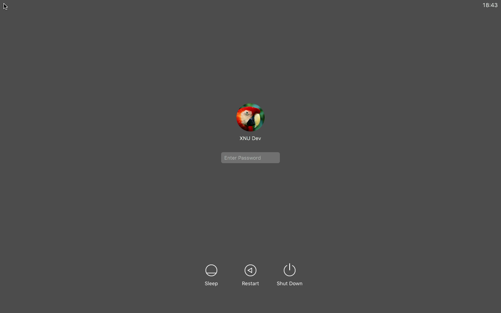
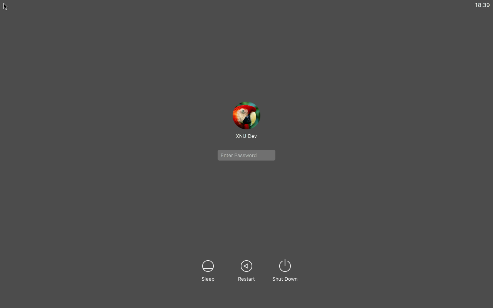
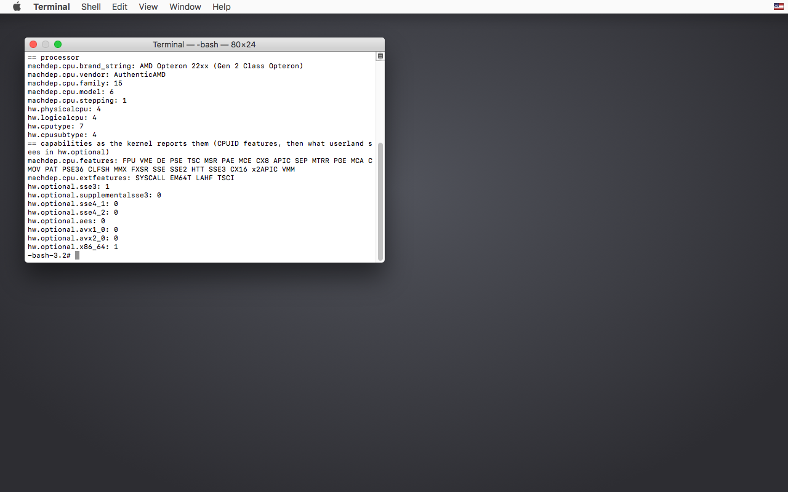
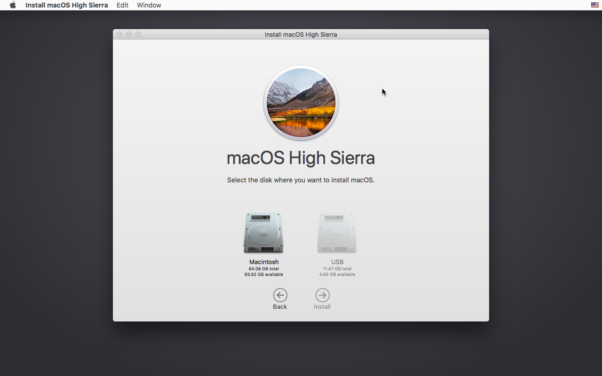
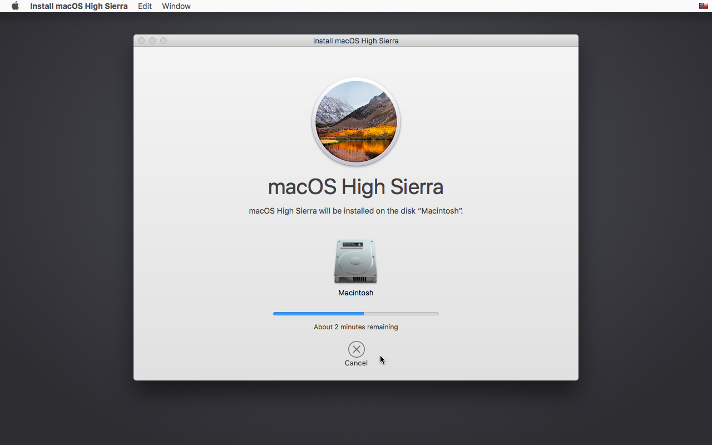
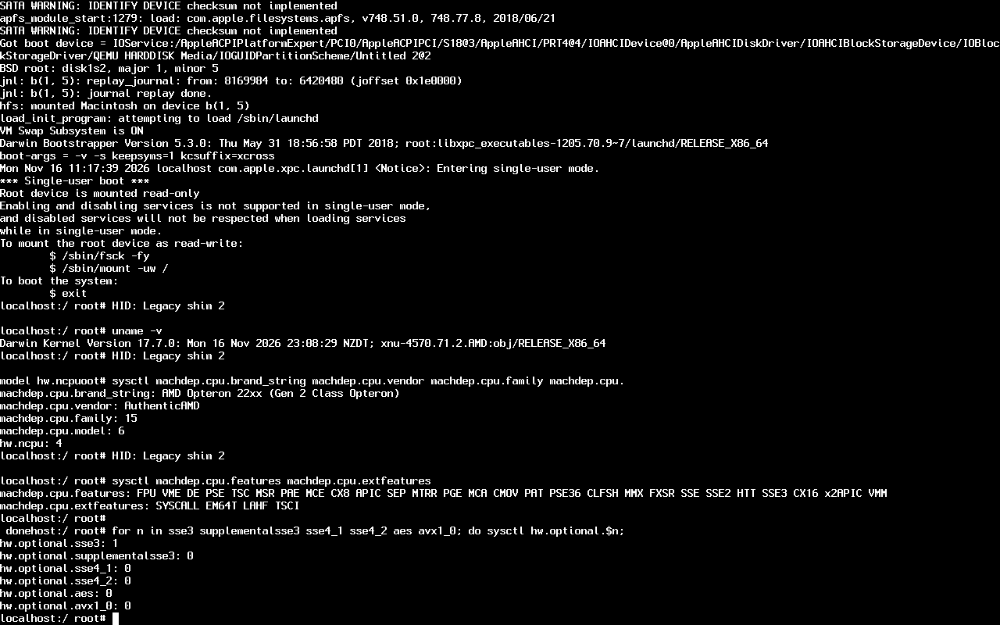
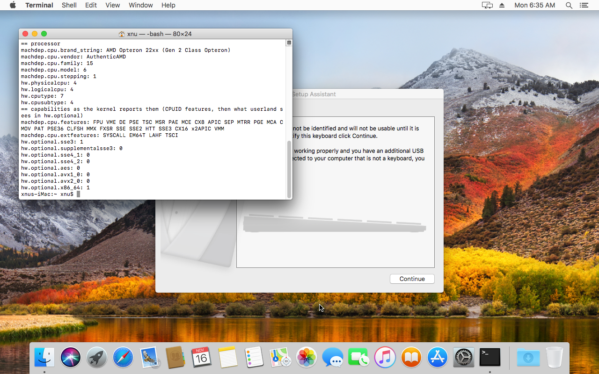
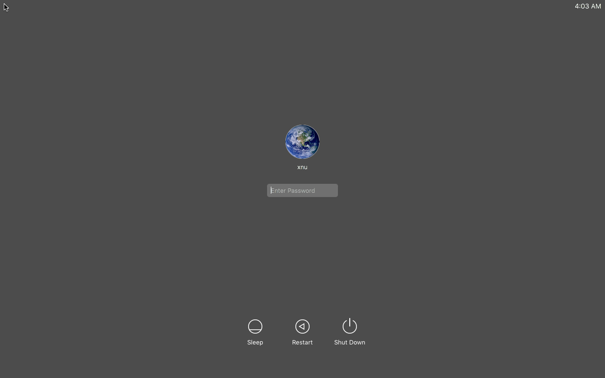
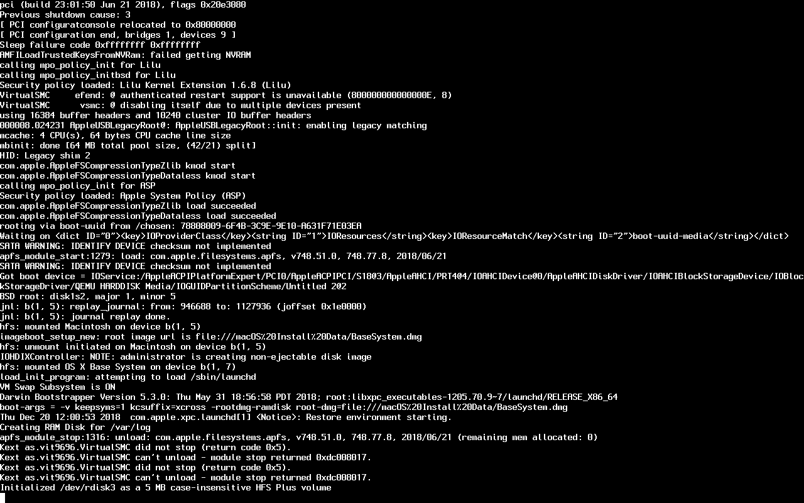
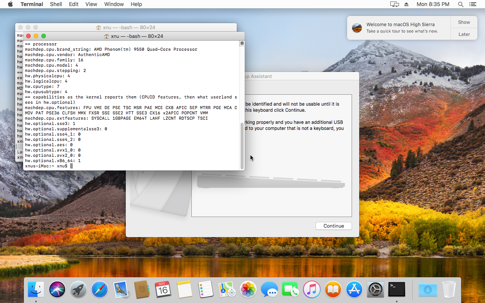

# Testing: macOS High Sierra

Every test here is a QEMU/KVM guest on an Intel host. **Nothing has been run on real AMD hardware.** KVM can present an AMD CPU (vendor, family, feature flags) but still executes SSSE3 and SSE4 natively, so these boots test the AMD kernel paths and not the opcode emulator. The emulator has its own host test, listed at the bottom.

## Boot Tests

Run with `scripts/amd-test.sh <profile>`. Each profile starts the VM with a different QEMU CPU model and waits for the login window.

| Profile | QEMU CPU | Guest reports | Result |
|---|---|---|---|
| `am2` | `Opteron_G2,vendor=AuthenticAMD,kvm=off` | AuthenticAMD, family 15 (K8) | Login window |
| `am3` | `phenom,family=16,model=4,stepping=2,vendor=AuthenticAMD,kvm=off` | AuthenticAMD, family 16 (K10) | Login window, about 3 minutes from selecting the volume |
| `am3plus` | `Opteron_G4,vendor=AuthenticAMD,kvm=off` | AuthenticAMD, family 21 (Bulldozer) | Login window |

The guest runs kernel `xnu-4570.71.2.AMD`, built with `XCROSS_MARCH=k8-sse3`.

### AM2 (K8)

### AM3 (K10)

### AM3+ (Bulldozer)

The stock kernel (Apple's xnu-4570.71.2 with toolchain fixes) and the AMD tree on an Intel CPU model also boot to the login window. No screenshot of those two was kept.

## Install From The Single Disk

Run on 2026-11-17 in the VM, with the install disk from [INSTALL.md](INSTALL.md). The kernel is `xnu-4570.71.2.AMD`, built with `XCROSS_MARCH=k8-sse3`, including the TSC calibration fix. CPU model for every row: `Opteron_G2,vendor=AuthenticAMD,kvm=off`, except where noted.

| Step | Result |
|---|---|
| Recovery on the install disk | `macOS Utilities`, Terminal reports the AMD kernel and CPU |
| Erase the target, installer stage 1 | Completes on our kernel |
| Stage 2 (clock 2018-12-21) | Reaches the installer GUI, then "The installer resources have expired" |
| Stage 2 (current date) | Installs to the end |
| Our kernel onto the new volume | Single-user mode on a `Penryn` model with `hs-single.sh` |
| First boot of the new volume | Setup Assistant, then the desktop |
| Single-user mode on the new volume | Root shell on our kernel |

The guest reports (`docs/tests/highsierra-clean-install-amd-k8.txt`):

| | |
|---|---|
| Kernel | `xnu-4570.71.2.AMD` |
| CPU | `AMD Opteron 22xx (Gen 2 Class Opteron)`, `AuthenticAMD`, family 15 |
| Features | SSE3 yes. SSSE3, SSE4.1, SSE4.2, AES, AVX no. |
| `hw.cpufrequency` | 2110000000 (the host runs at about 2.1 GHz) |

The installer's stage 2 on `Opteron_G2` hung with the kernel from before the TSC fix (screenshot at the end). With the fix it runs. STATUS.md says what that does and does not show.

### Terminal in Recovery, on our kernel

### The installer

### The installed system

The stage 2 hang on `Opteron_G2` with the older kernel:

## Stripped Kernel On A K10 Model

Run on 2026-11-17. The kernel is the K8 baseline build (`build/xnu-k8`) after `strip -S -x` with Apple's strip (13.0 MB instead of 15.5 MB), installed as `kernel.xcross`, with `prelinkedkernel.xcross` built around that stripped kernel on the installed system. QEMU model `phenom,family=16,model=4,stepping=2,vendor=AuthenticAMD,kvm=off`. The guest reports `AMD Phenom(tm) 9550`, family 16, kernel `xnu-4570.71.2.AMD`, SSE3 yes, SSSE3 and SSE4 no (`docs/tests/highsierra-stripped-kernel-amd-k10.txt`). It reached the login window and the desktop.

## Things The Profiles Need

- `vendor=AuthenticAMD` is mandatory under KVM. Otherwise QEMU reports the host's `GenuineIntel`, the kernel runs its Intel TSC path and divides by zero on family 16.
- The CPUID hypervisor bit stays on. boot.efi only accepts the iMac19,1 board-id when it believes it runs in a VM.
- Kernel `slide=100`. OVMF owns the memory at slide 0 in this VM.

## Emulator Tests

| Test | What it checks | Result |
|---|---|---|
| `scripts/opemu-hosttest.sh 20000` | 103 instruction forms (SSSE3, SSE3, SSE4.1, SSE4.2, POPCNT, CRC32) run on the host CPU and through the OPEMU C code, plus effective-address decoding and the decode, emulate and write-back pipeline | 12 million cases, 0 mismatches |
| `scripts/tcg-amd-boot.sh` | Boots under QEMU TCG (software CPU, raises real `#UD`) with an AMD model | Kernel and userland run through tens of millions of emulated instructions. `WindowServer`, `loginwindow` and `SecurityAgent` run. The login window was not reached in about 40 minutes, which is emulation cost: `SecurityAgent` was CPU bound and the load average was about 40. |

Under TCG the emulator handles about 64,000 instructions a second (it was about 8,000 before the `pshufb` and `palignr` fast path).
