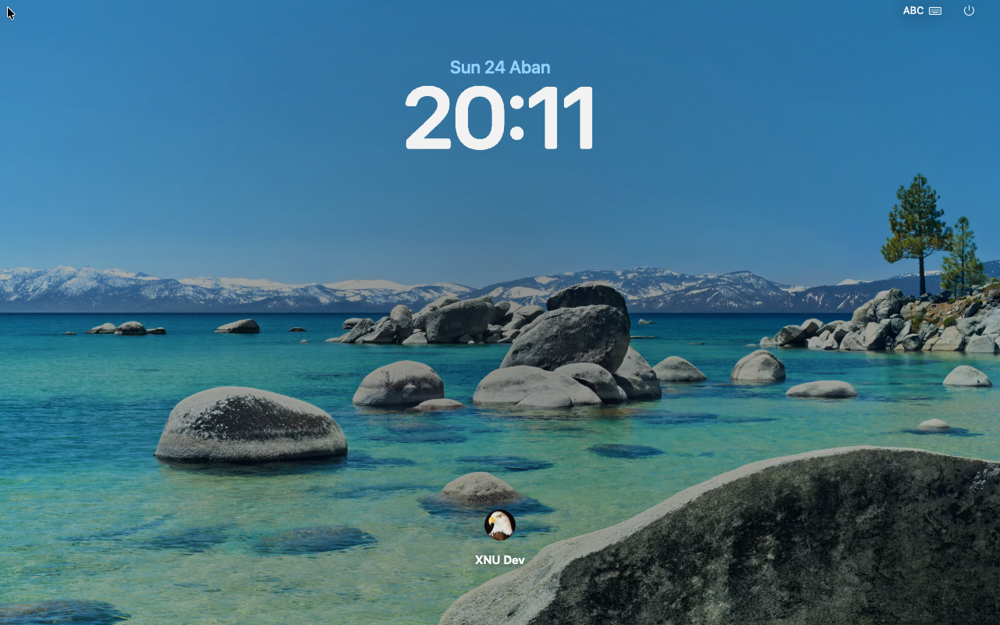
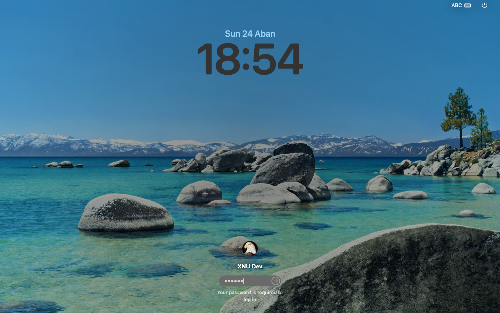

# Testing: macOS Tahoe

Every test here is a QEMU/KVM guest on an Intel host, with OpenCore, running Tahoe 26.7.3 (25G342). **Nothing has been run on real AMD hardware.** KVM presents an AMD CPU (vendor string, family, feature flags) but still executes AVX, AVX2, BMI and FMA on the host CPU, so these boots test the AMD kernel paths and not the opcode emulator. The emulator has its own host test, listed at the bottom.

The guest has no GPU acceleration. WindowServer renders in software, so the desktop takes 10 to 30 minutes to finish drawing after login and the load average goes into the hundreds. That is a property of the VM, not of the kernel.

## Boot Tests

`scripts/tahoe-cpu-test.sh <k8|k10|intel>` boots the installed kernel on a CPU model, waits for the login window, logs in as `xnu`, waits for the desktop, and saves screenshots to `docs/screenshots/` and the guest's own `sysctl` output to `docs/tests/`. `LOGIN_ONLY=1` stops after the login window, which is how the screenshots here were taken because the desktop takes so long.

| Kernel | QEMU CPU | Guest reports | Result |
|---|---|---|---|
| K10, `-march=amdfam10` | `phenom,family=16,model=4,stepping=2,vendor=AuthenticAMD,kvm=off` | AMD Phenom(tm) 9550, family 16, cpusubtype 8 | Login window. Logging in as `xnu` loaded a session (Calendar, Weather and Photos widgets drew, no panic). No screenshot of that was kept. |
| K8, `-march=k8-sse3` | `Opteron_G2,vendor=AuthenticAMD,kvm=off` | AMD Opteron 22xx, family 15, SSE3 and CX16, cpusubtype 8 | Login window. Not taken to the desktop, it is very slow. |

`cpusubtype 8` is `x86_64h` (Haswell). The kernel reports it on purpose. Tahoe ships only the Haswell dyld shared cache, so without it dyld finds no cache and `launchd` dies.

### K10 login window

The raw output from the guest is in [tests/tahoe-k10.txt](tests/tahoe-k10.txt). It was taken at the login window (`0 users`), five minutes after boot. The one odd OPEMU line in it, `add [rax], al` with all zero bytes, is a process jumping into zeroed memory, not a missing instruction.

### K8 login window

The password field shows six dots because the screenshot was taken after the password was typed. Raw output: [tests/tahoe-k8.txt](tests/tahoe-k8.txt). Its load average of 332 is what the software renderer does to a 4 CPU guest after login.

## Things The Boots Need

- `vendor=AuthenticAMD` is mandatory under KVM. Without it QEMU reports the host's `GenuineIntel` and the kernel panics with `Unsupported CPU`. The panic spins before the console is up, so the guest looks hung at the `HANDOFF TO XNU` line.
- Boot-args `-v keepsyms=1 debug=0x100 serial=3 auxKCAtBoot=false` and `csr-active-config` `0x87f`.
- After every kernel install `scripts/tahoe-kc-install.sh` makes a fresh bless snapshot. Skipping it can leave the guest rooting to an older snapshot, which panics with a System KC UUID mismatch.
- The guest USB keyboard stops delivering key events after a while. `scripts/vm.sh hotkbd` plugs in a new one.
- A guest GUI session also ignores the keyboard until it has seen a pointer event. `scripts/vm.sh wake` hot-plugs a relative mouse and moves it. Found on the High Sierra branch, where a Recovery session looked hung for half an hour; not yet needed or tried here.

## Emulator Tests

| Test | What it checks | Result |
|---|---|---|
| `scripts/opemu-avxtest.sh` | Every VEX encoding the engine supports is run on the host CPU and through `osfmk/OPEMU/opemu_avx.c`, and the registers and memory are compared. Covers AVX, AVX2, BMI1/2, MOVBE, FMA (with exact software fusing), F16C, ROUND, DPPS, MPSADBW, PHMINPOSUW, AES-NI and PCLMULQDQ | About 63,000 forms, 0 real mismatches (3 reported ones are artifacts of `rsi` being the test buffer pointer) |
| `scripts/opemu-hosttest.sh 20000` | SSE3, SSSE3, SSE4.1, SSE4.2, POPCNT and CRC32 against the host CPU, plus effective-address decoding and the decode, emulate and write-back pipeline | 0 mismatches |

Still not implemented in the AVX engine: the string-compare family (`vpcmpXstrX`), gathers, legacy-encoded AES-NI and PCLMUL, AVX-512, and `TZCNT` (it runs as `BSF` on K8 and K10 and cannot be trapped).

In the guest the K10 kernel logged one unsupported VEX instruction during boot, a `vpxor` with a bad address, which was a real fault and not a missing form.
